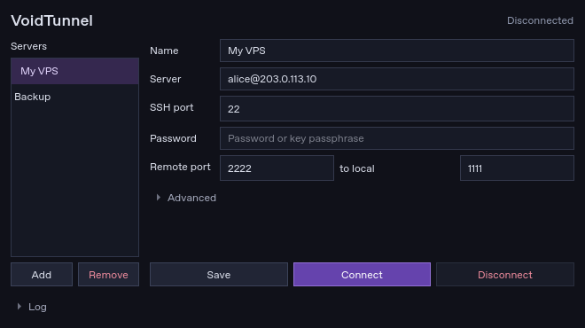

# VoidTunnel

Compact SSH reverse tunnel manager for Windows. C++17, Qt 6 and OpenSSH.



Save server profiles, connect with a password or key, and reconnect automatically after a dropped connection. Passwords can be stored with Windows DPAPI. New host keys are saved automatically; changed keys are rejected.

## Build

Install Qt 6.8 for MSVC 2022, Visual Studio 2022 C++ tools, and Windows OpenSSH Client 8.4+.

Run in an x64 VS developer terminal; replace the Qt path with yours:

```bat
cmake -S . -B build -A x64 -DCMAKE_PREFIX_PATH="C:/Qt/6.8.3/msvc2022_64"
cmake --build build --config Release
C:\Qt\6.8.3\msvc2022_64\bin\windeployqt.exe --release build\Release\VoidTunnel.exe
ctest --test-dir build -C Release --output-on-failure
```

Run `build\Release\VoidTunnel.exe`. This local build uses Qt DLLs.

For a single EXE, download **VoidTunnel-Windows-x64-portable** from the latest successful [Actions run](https://github.com/justillhackyou/VoidTunnel/actions). It links Qt and the MSVC runtime statically. Windows OpenSSH Client is still required. The first CI build compiles Qt; later runs reuse a cache.

## Use

Add a server as `user@host`, set the SSH port, and enter a password or choose a key under **Advanced**. Set the remote and local ports, then click **Connect**.

Remote `2222` → local `1111` forwards the server's port 2222 to port 1111 on your computer. Both ports are editable. Disconnect before changing an active profile. One tunnel runs at a time.

The default bind address, `127.0.0.1`, allows access from the server itself. Public access requires `0.0.0.0`, `GatewayPorts clientspecified` in sshd, and an open firewall port. The server must allow remote forwarding.

Profiles and host keys: `%LOCALAPPDATA%\VoidTunnel\VoidTunnel`. Save edits before switching profiles. Interactive MFA is not supported.

## Static build

The Windows workflow downloads Qt 6.8.3, builds it with `-static -static-runtime`, then builds VoidTunnel with `VOIDTUNNEL_STATIC_RUNTIME=ON`. The workflow contains the full build commands. Only Windows system DLLs are needed beside the EXE. Qt is used under LGPLv3; its license and source links are included under **About**. The application source and build scripts are available here for rebuilding with a modified Qt.
